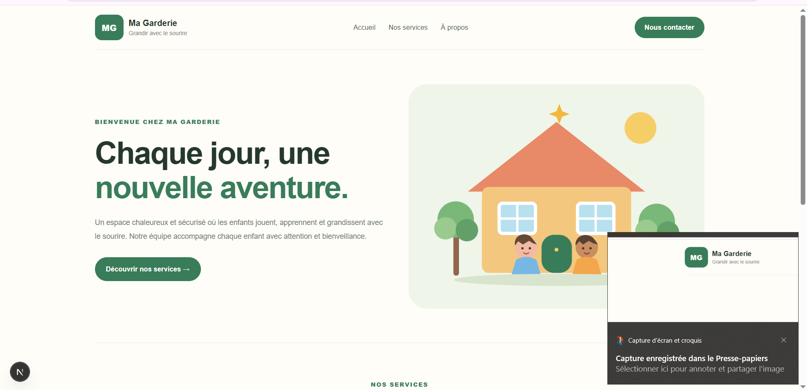
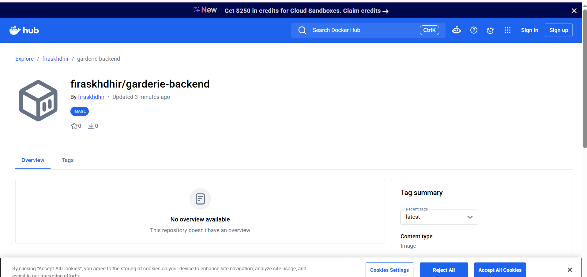
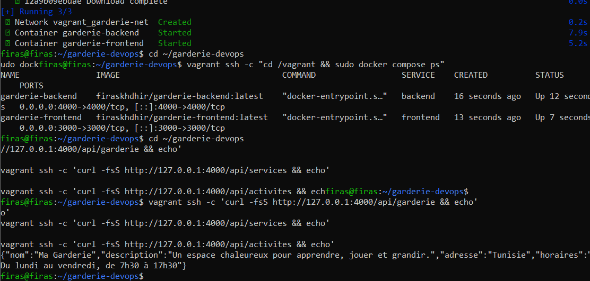
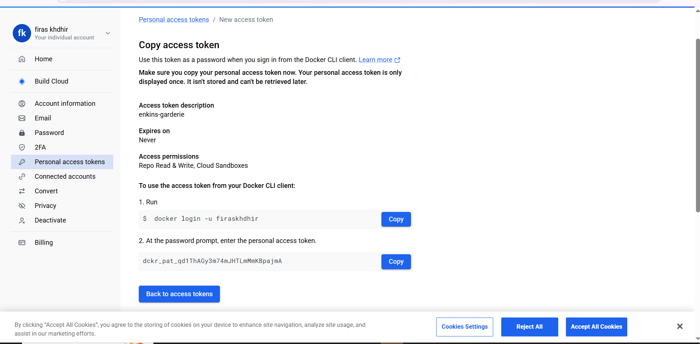

# Ma Garderie — Master DevOps & Cloud

## 1. Présentation

Ma Garderie est une application web responsive pour une garderie
d'enfants. Le projet utilise Next.js pour le frontend et Express
pour le backend.

## 2. Technologies

- Frontend : Next.js 15, React et CSS
- Backend : Node.js et Express
- API : REST et JSON
- Conteneurisation : Docker et Docker Compose
- CI/CD : Jenkins
- Provisioning : Vagrant et Ansible
- Dépôt source : GitHub

## 3. Architecture

- `frontend/` : interface web Next.js
- `frontend/tests/` : test automatisé du titre de la page
- `backend/` : serveur Express et API REST
- `frontend/Dockerfile` : image frontend
- `backend/Dockerfile` : image backend
- `docker-compose.yml` : communication entre les services
- `Jenkinsfile` : pipeline CI/CD
- `Vagrantfile` : configuration de la machine virtuelle
- `ansible/inventory.ini` : inventaire Ansible
- `ansible/site.yml` : playbook de provisioning
- `ansible/roles/docker/tasks/main.yml` : installation de Docker
- `screenshots/` : captures d'écran du projet

## 4. API REST

| Méthode | Route | Description |
|---|---|---|
| GET | `/api/garderie` | Informations générales |
| GET | `/api/services` | Liste des services |
| GET | `/api/activites` | Liste des activités |

## 5. Images Docker Hub

- Frontend : https://hub.docker.com/r/firaskhdhir/garderie-frontend
- Backend : https://hub.docker.com/r/firaskhdhir/garderie-backend

## 6. Déploiement avec Docker Compose

La machine virtuelle utilise les images publiées sur Docker Hub,
sans reconstruire les images localement.

Démarrer l'application depuis la racine du projet :

    vagrant ssh -c "cd /vagrant && sudo docker compose pull && sudo docker compose up -d"

Vérifier les conteneurs :

    vagrant ssh -c "cd /vagrant && sudo docker compose ps"

Les ports exposés dans la VM sont :
- Frontend : 3000
- Backend : 4000

Adresse à tester depuis une autre machine :
http://192.168.56.10:3000

L'accessibilité depuis Windows dépend de la configuration réseau
de VMware et VirtualBox.

## 7. Vérification des API

Depuis la machine Ubuntu qui héberge la VM :

    curl http://192.168.56.10:4000/api/garderie
    curl http://192.168.56.10:4000/api/services
    curl http://192.168.56.10:4000/api/activites

Les trois routes ont renvoyé des données JSON pendant les tests.

## 8. Test automatisé du frontend

Exécuter le test :

    cd frontend
    npm test

Résultat obtenu :
- 1 test réussi
- 0 échec

Le test vérifie la présence du titre « Ma Garderie » et du titre
de bienvenue dans le HTML de la page.

## 9. Vagrant et Ansible

La VM Ubuntu est configurée avec :
- 2 vCPU
- 2 Go de RAM
- Réseau privé : 192.168.56.10

Le provisioning Ansible utilise le rôle `docker` pour installer
Docker Engine, le plugin Docker Compose, activer le service Docker
et ajouter l'utilisateur vagrant au groupe docker.

Le dernier provisioning s'est terminé avec `failed=0`.

## 10. Pipeline Jenkins

Le pipeline est défini dans `Jenkinsfile` et contient les étapes :
- Checkout
- Install
- Test
- Build Frontend
- Build Backend
- Push Frontend
- Push Backend

L'identifiant Jenkins utilisé pour les identifiants Docker Hub est
`dockerhub-credentials`.

Le test et les deux étapes de construction ont réussi lors de
l'exécution observée. La publication depuis Jenkins reste à valider
après correction des identifiants Docker Hub.

## 11. Captures d'écran

Les captures actuellement disponibles :

### Capture 1

### Capture 2

### Capture 3

### Capture 4

Captures encore à vérifier ou compléter selon le contenu des images :
- Pipeline Jenkins exécuté avec succès, y compris les étapes Push
- Images présentes sur Docker Hub
- VM Vagrant démarrée
- Exécution réussie du playbook Ansible
- Conteneurs Docker en cours d'exécution
- Application affichée dans un navigateur depuis une autre machine

## 12. Dépôt GitHub

https://github.com/firaskhdhir11-lab/garderie-devops

